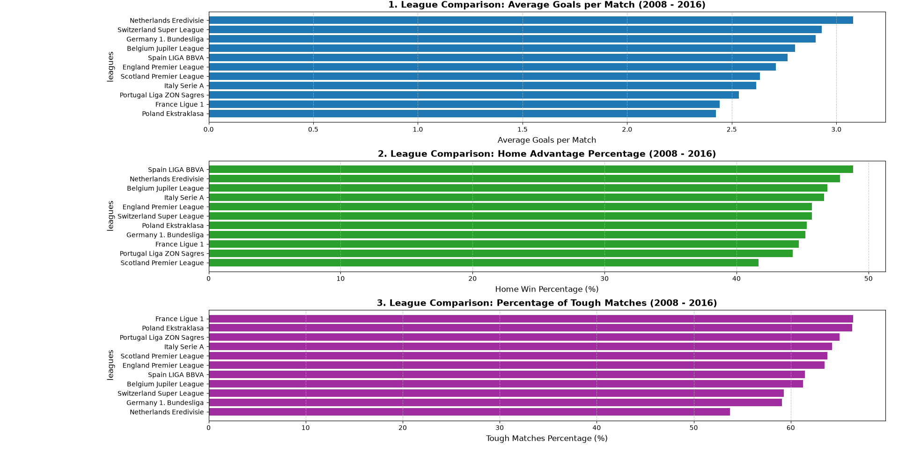

⚽ European Soccer Analytics Dashboard (2008–2016)
1. Header & Executive Summary

    Overview: A comprehensive data analytics project examining 8 full seasons of European soccer (2008–2016) using an SQLite database, Python, Pandas, and Matplotlib.

    For the Busy Manager: This report translates over 25,000 raw match records into actionable insights across European leagues. It quantifies league productivity (goal scoring), home-field advantage, and match competitiveness (tough/close games). The analysis provides a clear benchmarking framework for league competitiveness, scouting strategy, and sports analytics evaluation.

2. Business Problem & Context

    The Business Issue: Understanding league dynamics and competitive balance is critical for sports analysts, clubs, and betting or media organizations. Executives need to know whether certain leagues are overly dominated by hosts (strong home advantage), how tightly contested matches are across different divisions, and where goal-scoring output peaks.

    Why It Matters: Quantifying home advantage and competitive parity helps in valuation of broadcasting rights, identifying tactical trends across Europe, and designing fair or engaging tournament structures.

3. Data Architecture & Skills Used

    Tech Stack: Python, SQLite, Pandas, Matplotlib.

    Technical Highlights:

        Database Connection & Extraction: Direct execution of optimized SQL joins across relational tables (Match, League).

        Vectorized Data Transformations: Clean, efficient Pandas operations (dropping nulls, boolean masking, custom arithmetic difference calculations) avoiding slow iterative loops.

        Data Visualization Architecture: Subplot grid layout (plt.subplots) unifying three distinct behavioral metrics into a single multi-panel executive dashboard.

4. Methodology & Data Pipeline

    Extraction: Connected to the soccer_database.sqlite file and executed a base SQL query merging match results with league names across seasons 2008/2009 through 2015/2016.

    Cleaning & Validation: Filtered out records with missing league names or goal counts, ensuring zero null discrepancies.

    Feature Engineering:

        Calculated TotalGoals per match (HomeGoals + AwayGoals).

        Computed match outcome differentials (Result = HomeGoals - AwayGoals).

        Created boolean flags for HomeWin (Result > 0) and ToughMatch (Result.between(-1, 1) representing tight, highly competitive games decided by 1 goal or ending in a draw).

    Aggregation: Grouped metrics by LeagueName and computed league-wide means and percentage distributions, sorted ascending for clean horizontal bar plotting.

5. Key Results & Dashboard Preview

   

The analysis evaluates performance across 8 seasons, visualized in the unified dashboard below:

    Key Findings:

        Goal Productivity: Highlights which European leagues boast the highest and lowest average goals per match.

        Home Advantage: Quantifies the precise percentage of home wins per league, proving the universal strength of playing at home while exposing structural league variations.

        Competitiveness (Tough Matches): Maps out the proportion of tightly contested games, pinpointing where parity is highest.

6. Business Recommendations

    For League Regulators & Organizers: Leagues displaying abnormally high home win percentages or low competitive parity (high blowouts, low "tough match" percentages) should investigate refereeing biases, scheduling fairness, or financial distribution models to keep the competition engaging for fans.

    For Scouting & Analytics Departments: Teams operating in leagues with high defensive tightness and high percentages of "tough matches" (narrow margins) should prioritize defensive stability and set-piece efficiency, whereas high-scoring leagues demand high-octane offensive recruitment strategies.

7. Next Steps / Future Improvements

If given additional time and extended data sources, future iterations of this project could include:

    Advanced Metrics Integration: Incorporating Expected Goals (xG), shot counts, and disciplinary data (yellow/red cards).

    Predictive Modeling: Building a Machine Learning classification model (using scikit-learn) to predict match outcomes (Home Win / Draw / Away Win) based on historical team form.

    Interactive Web App: Deploying the dashboard onto an interactive web framework using Streamlit for dynamic filtering by season and team.
